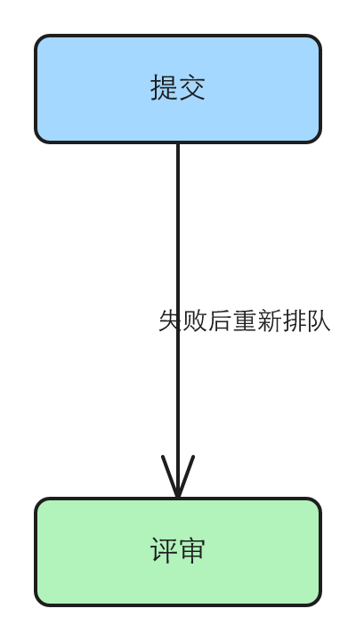

# 连线绕行、看图自检与箭头标签的三处小修

三个 issue 都是 #27（skill 分层）在 `release/0.6.0` 上实现时发现的，人决定一起放进 0.6.0。验证、实现都以 `origin/release/0.6.0` 为准：`skills/steps/` 只在那条分支上有，main 上还没有。

## 验证

| issue | 结论 | 证据 |
|---|---|---|
| #35 连线绕行（via）的 clearance 没写从哪条边量起 | 存在 | 2026-10-28 对着 `release/0.6.0`（4405ead）读 `skills/steps/references/connectors.md`：`clearance` 只在字段签名和一个示例里出现，没有一句说它从哪量起；读布线代码并用 `desugar` 跑三个例子确认了实际语义，详情在「问题」1 |
| #36 质量关 Layer B 没有「折行后一行只剩一个孤词」这一项 | 存在 | 2026-10-28 对着 `release/0.6.0`（4405ead）读 `skills/steps/SKILL.md` 的 Layer B：五条打分项里没有孤词；这条只在 comparison 入口 skill 的常见画坏法和 panel 参考里出现，详情在「问题」2 |
| #38 箭头上的中文标签宽度按「字数 × 9」估，比实际窄，每次误报 TEXT_OVERFLOW_X | 存在 | 2026-10-28 对着 `release/0.6.0`（4405ead）用库的 `desugar` + `render` 复现：「失败重跑」框宽 36、估算字宽 56，报 TEXT_OVERFLOW_X；issue 推测的竖直线段旁压线也复现到了，详情在「问题」3 |

## 问题

### 1. 绕行的 clearance 不知道该填多少

connectors.md 的「长距离绕行：`via`」一节只给了一个 `clearance: 90` 的示例，`routeU` 的说明写的是「`clearance` 是离开多远」。从哪离开、离开谁，没写。#27 实现时子代理靠试，试出了 50。

读代码（`routeU`）和实测得到的实际语义：绕行那一段（`via: "below"` 时是底下那条横线）放在**两个连接点里更靠绕行方向的那一个**之外 `clearance` 像素。连接点是 `fromSide` / `toSide` 定的那条边上的点，不是框的外沿；不写 `clearance` 默认 60。它**只看两个端点，不看沿途别的框**。

同一排三个框（A、M、C，顶边都在 y=40），从 C 回连到 A，`via: "below"`：

| 例子 | 连接点 | clearance | 底下横线的 y | Layer A |
|---|---|---|---|---|
| 三个框都高 60，出入边都写 bottom | 都在 y=100 | 50 | 150（离框底 50） | 干净 |
| 同上，但中间的 M 高 140（框底在 y=180） | 都在 y=100 | 50 | 150，从 M 中间穿过 | ARROW_CROSSES_SHAPE |
| 三个框都高 60，`fromSide: "left"`（C 左边中点 y=70）、`toSide: "bottom"`（y=100） | 70 和 100 | 20 | 120（离更低的 100 再往下 20） | 干净 |

所以 agent 要的算法其实很简单：`clearance` = 想留的空隙 + 沿途最突出的那个框超出更靠外那个连接点的距离。文档没写，就只能试。

复现材料：`.tmp/to-spec/connector-and-gate-fixes/repro/clearance.mjs` 与 `clearance.out`（本地，不提交）

### 2. 只照 Layer B 自检会漏掉孤词

`skills/steps/SKILL.md`「出图」→ 两层质量关 → Layer B 的五条（Labels、Arrows、Spacing、Canvas、Readability）里，Labels 一条只管「居中、整个在框里、没被截」。文字折行后最后一行只剩一个词，这五条都不判 FAIL。

同一个毛病在两处已经写着：comparison 入口 skill 的常见画坏法表（「一张卡折行后最后一行只剩一个孤零零的词」）和 panel 参考（「折行后最后一行只剩一个词时，缩短这句或自己换一处行」）。画 flowchart、architecture 等别的图的 agent 不读这两处，只照 Layer B 自检，就会放过它。

### 3. 中文箭头标签每次误报 TEXT_OVERFLOW_X，竖直线旁的还会压线

给按 id 连的箭头写 `text`，标签框宽按「字符数 × 9，最少 28」算，不分中英文、不看字号；Layer A 量文字宽用的是按字符类型算的估宽（中文一个字等于字号，14 号就是 14px）。

| 标签 | 所在线段 | 框宽 | 估算字宽 | Layer A |
|---|---|---|---|---|
| 失败重跑 | 横 | 36 | 56 | TEXT_OVERFLOW_X |
| Retry fail | 横 | 90 | 87 | 不报 |
| 失败后重新排队 | 竖 | 63 | 98 | TEXT_OVERFLOW_X |

横线上的标签是居中摆的，框窄了文字照样以框中心居中显示，所以图上看不出问题，警告是误报；agent 为了清掉它，只能把标签改成单独摆放的文字绕过去（#38 里记的实际发生过）。

竖线上的不一样：标签框贴着线摆在一侧（框的左边离线 6px），文字却按框中心居中，框比字窄 35px，字就往线那边多出 17px，压到线上：

复现材料：`.tmp/to-spec/connector-and-gate-fixes/repro/repro.mjs` 与 `repro.out`（本地，不提交）

### 根因

- 问题 1：`routeU` 的语义只写在代码注释里（「detour distance past endpoints」），搬进 connectors.md 时只留了字段签名和示例。
- 问题 2：Layer B 的打分项写的时候没收这一条，后来各处画坏法里补了，没回填到 Layer B。
- 问题 3：sugar 里给箭头标签定框宽的那一处自己写了「字数 × 9」，没用仓库里节点文字、模板边标签、Layer A 都在用的按字符类型估宽。修正：issue 原先推测竖线旁的中文标签「可能」压线，实测确实压线。

## 方案

用户（照 skill 画图的 agent，和直接用 sugar 的人）最终得到：

- 读 connectors.md 就能算出 `clearance`：知道它从哪量起、默认多少、要不要把沿途更突出的框算进去，并看到一个带数字的例子。
- 照 Layer B 自检时，标签折行后最后一行只剩一个词会被判 FAIL，并知道怎么修。
- 箭头标签的框宽跟着文字实际宽度走：中文标签不再误报 TEXT_OVERFLOW_X，竖线旁的中文标签不再压线；英文标签的框宽几乎不变。

同一行为的入口，逐个：

| 入口 | 本次 |
|---|---|
| sugar 按 id 连的箭头 / 线（L1–L3）的 `text` | 纳入：就是出问题的那一处 |
| sugar L4（自己给 points）的箭头 / 线的 `text` | 纳入：走同一个定框宽的地方 |
| flowchart 模板的边标签 | 排除：已经按字符类型估宽（另加 8px 余量），没有这个问题 |
| connectors.md 里 `routeU` helper 的一行说明 | 纳入：`clearance` 语义跟 `via` 相同，一起写清 |
| `compute_layout` 工具里 `routeU` 的参数说明 | 排除：只列字段名，详细语义指给 connectors.md 即可 |
| 别的入口 skill 的常见画坏法 | 排除：Layer B 是所有图都过的一关，写在那里一处就够 |

## User Stories

只修问题，每个问题一行期望行为：

1. 作为照 skill 画回边的 agent，我想要文档写明 `clearance` 从更靠绕行方向的那个连接点量起、只看两端、默认 60，以便一次算出够用的值，不靠试。
2. 作为照 Layer B 自检的 agent，我想要「折行后最后一行只剩一个词」判 FAIL 并写明修法，以便画任何类型的图都能发现它。
3. 作为给箭头写中文标签的 agent，我想要标签框宽按文字实际宽度定，以便 Layer A 不再误报、竖线旁的标签不压线，不用把标签改成单独的文字绕开。

## 实现决策

- **clearance 写在 connectors.md 的「长距离绕行：`via`」一节**，示例下面补一段：从哪量起（`via` 方向上更靠外的那个连接点，连接点由 `fromSide` / `toSide` 定）、默认 60、只看两端不看沿途、沿途有更突出的框要把超出的距离加上；配「问题」1 表里前两行那样带数字的例子。建议出入边写成跟 `via` 同一侧（`via: "below"` 配两个 `bottom`），这时 `clearance` 就是线离框底的距离，最好算。`routeU` helper 那一行说明改成指向同一段语义。依据：代码现状（`routeU` 与 sugar 里的默认值 60）。
- **孤词并进 Layer B 的第 1 条（Labels）**，不新加第 6 条：Layer B 正文里写着「loop until all five PASS」，并进去不动条数，改动最小（`idea-loop:decision-rules` 第 4 条「默认改动最小」）。写法：标签折行后最后一行只剩一个词也算 FAIL；修法是缩短这句或自己在合适处用 `\n` 换行，让几行长度接近——跟 comparison 入口 skill、panel 参考里现成的修法一致。
- **箭头标签框宽改用按字符类型的估宽**，取各行（按 `\n` 分开）里最宽的一行，保留最少 28 的下限，字号仍是 14、框高仍是 18。依据：仓库里已有的统一做法——节点文字、flowchart 模板边标签、Layer A 的 TEXT_OVERFLOW_X 都用同一个估宽。框宽跟 Layer A 用同一把尺，误报就消失；竖线旁贴边摆的框宽够了，居中的文字就不会越过框的贴线那一边。
- **CHANGELOG** 只在 Unreleased 下记（Fixed：箭头标签框宽；Docs 类的两处写进同一节或 Changed，跟现有条目的分节方式一致），版本号由发版会话写。

## 技术方案总览

### 后端

不涉及。

### 前端内部

不涉及。

### 前端交互

不涉及。

## 测试决策

| 变的是什么 | 仪器 | 本次 |
|---|---|---|
| 纯逻辑、数据转换、状态机 | TDD 单元测试 | 箭头标签框宽：TDD |
| API 契约（路由、schema、序列化） | TDD API 测试 | 不涉及 |
| DB schema、迁移、并发与事务语义 | 真 DB 测试 | 不涉及 |
| LLM 输出质量（prompt 改动） | eval（确定性断言） | 不涉及：两处 skill 文档改动是说明补全，不改流程；由实现时照文档画一次回边、看一次 Layer B 人工核 |
| 视觉正确性 | UI 实现环 | 不涉及 |
| 端到端用户流程 | 浏览器端到端测试 | 不涉及 |

- **seam**：库的 `desugar()` + `validate()`（或 `render()` 返回的 `warnings`）。能抓到：标签框宽、标签框与线的相对位置、Layer A 是否报警。漏掉：字体实际渲染出的像素宽（估宽本身的误差），这一层由出图后看 PNG 补。
- **增量功能测试**：
  - 前置：两个横排的框，按 id 连箭头，`text: "失败重跑"`。步骤：`desugar` 后 `validate`。期望：没有 TEXT_OVERFLOW_X；标签框宽不小于中文 4 字 × 14。覆盖：期望行为 3。
  - 前置：两个竖排的框，按 id 连箭头，`text: "失败后重新排队"`。步骤：`desugar`。期望：标签框整个在线的一侧，框宽不小于文字估宽，所以居中的文字不越过线。覆盖：期望行为 3。
  - 前置：英文标签 `"Retry fail"`。期望：没有警告，框宽跟文字估宽一致（回归）。覆盖：期望行为 3。
  - 期望行为 1、2 是文档：实现时照新写的 connectors.md 算一次「问题」1 表第二行（中间框高 140）的 clearance，渲染后 Layer A 干净；Layer B 的 Labels 一条读得出孤词判 FAIL。
- **prompt / eval 变动**：无 prompt/eval 变动。
- **照着谁写**：`tests/sugar.test.mjs`（`desugar` 后断言元素字段）、`tests/validate.test.mjs`（断言 warning 的 code）。

## Out of scope

- flowchart 模板的边标签：已经按字符类型估宽。
- 多行箭头标签的框高：本次只改宽，框高仍固定 18；没有复现过多行标签的问题，不顺手改。
- 估宽本身的精度（中文按字号、拉丁按 0.62 倍字号）：Layer A 和节点文字共用它，改它是另一件事。
- 给 `routeU` 加「自动避开沿途框」的能力：本次只把现有语义写清。

## 关联

- 覆盖：#35 连线绕行（via）的 clearance 没写从哪条边量起；#36 质量关 Layer B 没有「折行后一行只剩一个孤词」这一项；#38 箭头上的中文标签宽度按「字数 × 9」估，比实际窄，每次误报 TEXT_OVERFLOW_X。
- [[skill-layers]]（#27）：本 spec 改的 `skills/steps/` 由它建出，已合进 `release/0.6.0`。
- 相邻未完成：#12 新图类型同时在往 `release/0.6.0` 改 `skills/steps/`，本次只动 connectors.md 的「长距离绕行」一节、SKILL.md 的 Layer B 第 1 条，重叠面小，合并前先合入最新的 `release/0.6.0`。#24 CJK 折行后拉丁行字体回退：管字体选择，不改测量结果，与本次 #38 不重叠。#15 0.6.0 发版：本次实现合进 `release/0.6.0`，由它发版。
