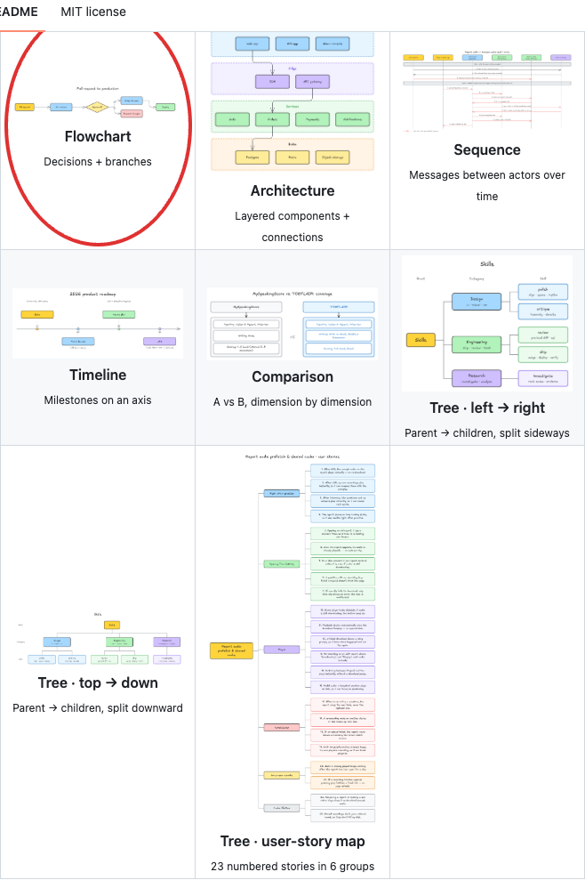
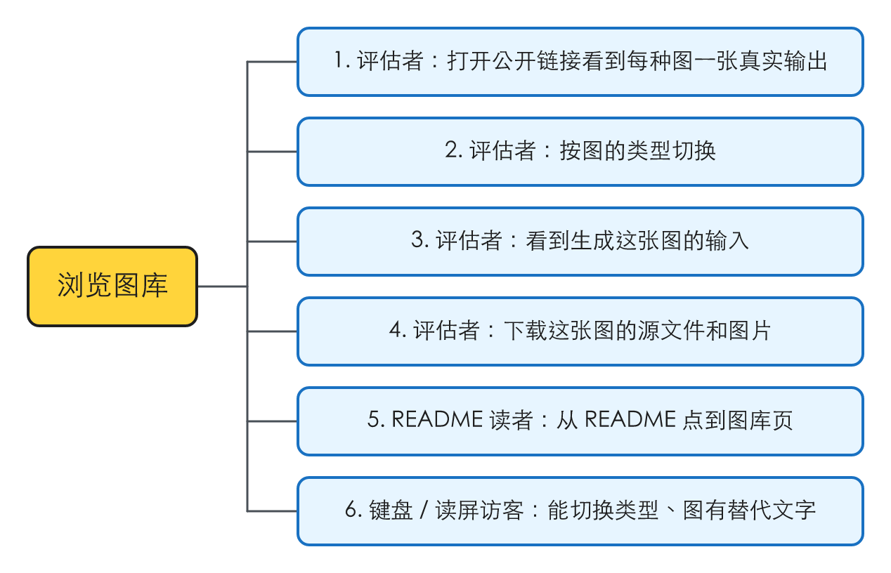
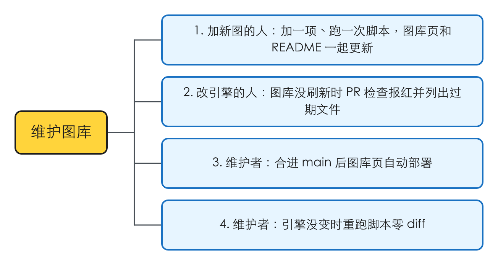
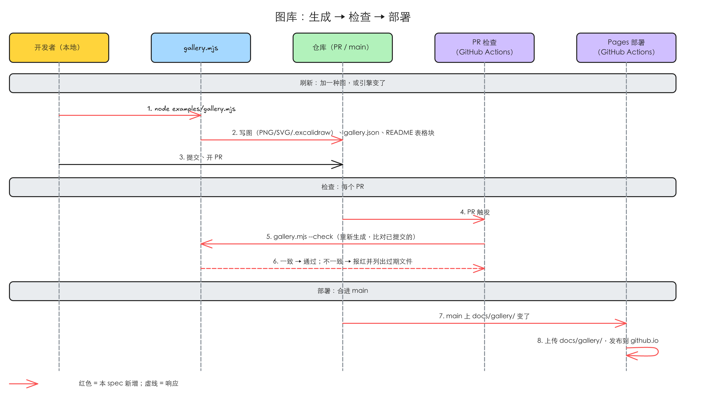

# 公开示例图库

## 验证

| issue | 结论 | 证据 |
|---|---|---|
| #25 Public example gallery | 存在 | 2026-10-26 对着 `main`（17d0a7f）核：仓库没开 GitHub Pages，没有任何能在仓库外浏览的图库页；图只在 README 里，只有 PNG，详情在「问题」 |

## 问题

### 1. 仓库外没有能浏览的图库，README 里的图只有 PNG

红圈是为说明叠加的，不属于页面：每一格只有一张 PNG、一个名字、一句说明，看不到生成它的输入，也拿不到 `.excalidraw` 源文件。

现在「每种图长什么样」只有一个答案：README 的 *What it makes* 一节，一张 3 列的表，8 张 PNG（6 种图，tree 占 3 张），图存在 `docs/gallery/`，由 `node examples/gallery.mjs` 生成并提交。本次核到的：

- `gh api repos/guohaonan-shy/excalidrawer/pages` 返回 404：仓库没开 GitHub Pages，没有公开页面。
- `npm pack --dry-run` 的清单里没有一个 `docs/` 下的文件（#20 把 `docs/` 排除出了 tarball）。npm 页面上的 README 图能不能显示没核成：npmjs.com 对无头浏览器弹了机器人验证页。
- `PRODUCT.md` 写的落地页 `excalidrawer.soloworks.io` 现在没有响应（2026-10-26 `curl` 连不上），这个站不在本仓库，也不在 `guohaonan-shy` 名下任何仓库里。
- `PRODUCT.md` 的设计原则里有「生成而非绘制：任何画面都要让『代码 → 图』的关系一眼可见」和「输出可编辑：任何导出路径都保留 `.excalidraw` 源文件」，README 这张表两条都做不到。

对「从社交媒体刷到一张手绘图点进来的开发者」（`PRODUCT.md` 的第三类用户）：他要在几秒内看出这是生成工具，现在只能落在 GitHub README 上。

复现材料：`.tmp/to-spec/example-gallery/repro/`（本地，不提交）

### 2. 加一种图要改好几处，没有写下来的约定

`examples/gallery.mjs` 的 `figures` 表是图的来源，但 README 的表格是手写的：加一种图要在脚本里加一项、跑脚本、再手改 README 的表格行（图名、说明、链接）和表头那句「Six diagram types」里的数字。#12 要在 0.6.0 加 5 种图，每种都要走一遍。

本次重跑 `node examples/gallery.mjs`：8 张图全部 lint clean，`git status` 无改动，生成是确定的。

### 根因

- 问题 1：不涉及（新能力）。
- 问题 2：图的元数据（名字、说明）只写在 README 里，没跟 `figures` 表放在一起。

## 方案

用户最终得到：

- 一个公开的图库页 `https://guohaonan-shy.github.io/excalidrawer/`：每种图一个 tab，每张图能看到生成它的输入，能下载 `.excalidraw`、SVG、PNG。
- 加一种图只改一处：在 `examples/gallery.mjs` 的图表里加一项，跑一次 `node examples/gallery.mjs`，提交它改动的文件。图库页和 README 的表格都由这次运行更新，不手改。
- 图库忘了刷新的 PR 会被检查拦住；合进 `main` 后图库页自动部署。

同一行为的入口，逐个：

| 入口 | 本次 |
|---|---|
| `examples/gallery.mjs` | 纳入：图库的唯一来源，产出图、源文件、输入、清单和 README 表格块，另有 `--check` |
| `docs/gallery/` | 纳入：图库页本身和它的全部资源都住这里，Pages 只部署这个目录 |
| README *What it makes* 表格 | 纳入：由脚本重写标记之间的部分，加一句指向图库页的链接 |
| PR 检查 workflow | 纳入：新加，跑 `--check` |
| Pages 部署 workflow | 纳入：新加 |
| `examples/comparison-figures.mjs`、`examples/tree-figures.mjs` | 纳入：照旧被 `gallery.mjs` 引用，不改 |
| `docs/diagram-types.md` 的「Example gallery」一节、`CLAUDE.md` 里 `docs/gallery/` 那条 | 纳入：开放问题改成指向本 spec；`CLAUDE.md` 写上图库页、`--check` 和加图约定 |
| 落地页 `excalidrawer.soloworks.io` | 排除：见 Out of scope |
| `docs/agent-eval.md` 的对照样本 | 排除：见 Out of scope |

## User Stories

### 浏览图库

1. 作为评估这个项目的开发者，我想要打开一个公开链接就看到每种图一张真实输出，以便几秒内判断它能画什么
2. 作为评估这个项目的开发者，我想要按图的类型切换，以便直接看我关心的那一种
3. 作为评估这个项目的开发者，我想要看到生成这张图的输入，以便确认它是从代码生成的、不是手画的
4. 作为评估这个项目的开发者，我想要下载这张图的 `.excalidraw`、SVG 和 PNG，以便在 Excalidraw 里打开改，或直接拿去用
5. 作为读 README 的人，我想要 README 的图库表格旁有指向图库页的链接，以便从 README 也能到图库
6. 作为用键盘或读屏的访客，我想要能用键盘切换类型、图有替代文字，以便不靠鼠标和视力也能用

### 维护图库

1. 作为加新图类型的开发者（#12），我想要在图表里加一项、跑一次脚本，图库页和 README 就一起更新，以便不用手改多处
2. 作为改渲染引擎的开发者，我想要图库没刷新时 PR 检查报红并列出过期的文件，以便不会把旧图发出去
3. 作为维护者，我想要合进 `main` 后图库页自动部署，以便线上页面跟 `main` 上提交的图一致
4. 作为维护者，我想要引擎没变时重跑脚本零 diff，以便刷新的 PR 里只有真实变化

## 实现决策

### 图库放在 GitHub Pages，本仓库里的静态单页

图库页和它的资源都放在 `docs/gallery/`：一个手写的 `index.html`（无构建步骤，不引新依赖），加上脚本产出的图、源文件、输入和清单。一个 Pages workflow 在 `main` 上 `docs/gallery/` 有变化时（以及手动触发时）只把这个目录上传部署。落地页以后建起来，直接引用这里的图。

依据：人在 2026-10-26 的决定「GitHub Pages 单页」（[[2026-10-26-example-gallery-decisions]]）。

开 Pages 要人在仓库 Settings → Pages → Build and deployment → Source 选「GitHub Actions」：这是对外发布，只由人做（`idea-loop:decision-rules`「不自动的」）。实现 PR 合进的是 `release/0.6.0`，图库页第一次部署发生在 #15 把 `release/0.6.0` 合进 `main` 时，所以要在那之前开好。

### 手动刷新，PR 检查拦住过期的图

刷新照旧是手动跑 `node examples/gallery.mjs` 并提交产物。脚本加 `--check`：在内存里重新生成一遍，跟已提交的逐个比对，有不一致、缺文件或多出没人产出的文件，就以非零退出码结束，并列出每个有问题的文件；全一致退出码 0。新加一个 PR 检查 workflow，对每个 PR 跑 `npm ci` 和 `node examples/gallery.mjs --check`。

- 比对 `gallery.json`、每张图的输入、`.excalidraw`、SVG 和 README 标记之间的内容，**不比对 PNG 的字节**，只检查 PNG 在不在：PNG 由 resvg 光栅化，macOS 和 CI 的 Linux 可能差几个像素。
- SVG 在 CI 上若被证实跨平台不一致（实现时在 CI 上用 macOS 生成的文件跑一次 `--check` 验证），就把 SVG 也降为只查存在，在实现 PR 里写明。
- 不在发版时由 CI 重新生成：那样提交的图和线上的图会不一致，PR 里也看不到图变了什么。

依据：人的决定「手动刷新加检查」。

### 不兼作 agent-eval 的对照样本

图库和 `docs/agent-eval.md` 的对照样本各维护各的清单。能共用的只是生成函数：`examples/comparison-figures.mjs` 已经被图库 import，以后 eval 照样 import 同一份函数。

依据：人的决定「不兼作 agent-eval 样本」。

### 图表里的一项长什么样（给 #12 的加图约定）

每一项带：slug（文件名用）、所属类型（tab 用，tree 的 3 张图同属一个类型）、类型的显示名、这张图的名字、一句说明，以及生成方式和输入二选一：

- 用模板生成的：模板名 + 交给模板的数据；
- 用 sugar 拼的：一个返回 sugar 元素数组的函数。

页面上展示的「输入」就是这份数据或这个数组本身，原样序列化成 JSON，不是另写的示意。图表的顺序就是 tab 和 README 表格的顺序。

**加一种图的约定**：在 `examples/gallery.mjs` 的图表里加一项，跑 `node examples/gallery.mjs`，提交 `docs/gallery/` 和 `README.md` 的改动。不需要改 `index.html`、不需要手改 README。这条也写进 `CLAUDE.md` 和脚本开头的注释。依据：#15 写明「#25 … gains a figure for each new type as #12 lands」。

### 脚本的产出

每跑一次，对每一项在图库目录写：PNG（README 用，2 倍）、SVG（页面用，字体内嵌）、`.excalidraw`、输入的 JSON；再写一份 `gallery.json` 清单（每一项的上述字段和文件名），并重写 README 里一对标记注释之间的内容。

- README 标记之间的内容：一句「N diagram types」（N 是不同类型的个数）、指向图库页的链接、3 列表格（格式照现在的表）。标记之外的内容（比如「New in 0.5.14」那句）不碰。README 里找不到成对的标记，脚本报错退出，不写任何文件。
- 脚本接受可选的输出目录和 README 路径参数，默认是 `docs/gallery/` 和仓库根的 `README.md`，测试用它们指向临时目录。
- 图表里删掉的一项，它的旧文件由脚本删掉；`--check` 把这类多出来的文件报为过期。
- `.gitignore` 现在全局忽略 `*.svg`、`*.excalidraw`，只放行了 `docs/gallery/*.png`，要同样放行图库目录下的 SVG 和 `.excalidraw`。

### 图库页的结构

单页，英文（跟 README 一致），从 `gallery.json` 读出所有项，不在 HTML 里写死任何一张图：

- 页头：项目名、一句定位、去 GitHub 和 npm 的链接。
- 一排类型 tab，顺序同图表；一个类型下有几张图（tree 有 3 张）就在 tab 里依次排开。
- 每张图一块：图（SVG，点开看原尺寸）、名字和一句说明、可展开的「Input」区展示输入 JSON 并标明是哪个模板或 sugar、下载 `.excalidraw` / SVG / PNG 的链接。
- 可访问性按 `PRODUCT.md` 的 WCAG AA：tab 能用键盘切换、读屏可达，每张图有替代文字（用名字和说明），文字对比度实测 ≥ 4.5:1。

视觉方向和细节由设计阶段在这个结构之内定，不重开结构。

## 技术方案总览

### 后端

- 没有服务端接口。新增两个 GitHub Actions workflow：PR 检查（每个 PR 跑 `--check`）和 Pages 部署（`main` 上 `docs/gallery/` 变了就部署这个目录）。
- 图库页对外的「接口」是 `docs/gallery/gallery.json` 的形状，见「实现决策 · 图表里的一项长什么样」。

### 前端内部

不涉及：页面只在加载时读一次 `gallery.json`，没有缓存和跨页状态。

### 前端交互

待补图：uiux-refine 冻结时按冻结画布补交互图，替换本节文字。

- 打开图库页 → 显示第一个类型的 tab 和它下面的图。
- 点另一个类型的 tab（或用键盘切过去）→ 换成那个类型的图。
- 点一张图 → 看原尺寸。
- 展开「Input」→ 显示生成这张图的输入 JSON 和它用的模板或 sugar。
- 点下载链接 → 下载这张图的 `.excalidraw` / SVG / PNG。
- `gallery.json` 加载失败 → 页面说明图库暂时打不开，并给出 GitHub 仓库的链接。

## 测试决策

| 变的是什么 | 仪器 | 本次 |
|---|---|---|
| 纯逻辑、数据转换、状态机 | TDD 单元测试 | 碰到：脚本产出清单、重写 README 标记块、`--check` 判过期，走 TDD |
| API 契约（路由、schema、序列化） | TDD API 测试 | 碰到：`gallery.json` 的形状，在同一组测试里断言 |
| DB schema、迁移、并发与事务语义 | 真 DB 测试 | 不涉及 |
| LLM 输出质量（prompt 改动） | eval（确定性断言） | 不涉及 |
| 视觉正确性 | UI 实现环（`idea-loop:ui-measure`，逐格比对冻结画布） | 碰到：图库页照冻结画布逐格比对 |
| 端到端用户流程 | 浏览器端到端测试 | 碰到，但不写进仓库：仓库没有浏览器测试设施，图库页的点击走查做成人验素材（本地静态服务器打开页面，逐个 tab、展开输入、点下载） |

- **seam**：只有一个，`examples/gallery.mjs` 作为进程运行（带输出目录和 README 路径参数，指向临时目录）。它能抓到：清单和文件是否齐全一致、README 标记外的内容是否原样、`--check` 的退出码和列出的文件。漏掉的：页面怎么显示这些文件、Pages 部署本身，前者由 UI 实现环和走查覆盖，后者在 `release/0.6.0` 合进 `main` 后看线上页面。
- **增量功能测试**：
  - 前置：临时目录里一份带成对标记的 README。步骤：跑脚本。期望：清单列出图表里每一项，每项的 PNG、SVG、`.excalidraw`、输入文件都在；README 标记外的字节不变，标记内的表格每一项一格、「N diagram types」的 N 等于类型数。覆盖：维护图库 1。
  - 前置：刚生成的目录。步骤：跑 `--check`。期望：退出码 0。覆盖：维护图库 4。
  - 前置：刚生成的目录，改一个 SVG 的内容 / 删一个 `.excalidraw` / 多放一个没人产出的文件 / 改 README 标记内一行。步骤：跑 `--check`。期望：每种情况都非零退出，输出里点名那个文件。覆盖：维护图库 2。
  - 前置：README 里没有标记。步骤：跑脚本。期望：报错退出，输出目录和 README 都没被写。覆盖：维护图库 1。
  - 走查（人验素材）：本地起静态服务器打开 `docs/gallery/index.html`，逐个 tab 看图、展开输入、点三个下载链接，键盘 Tab / 方向键能切类型。覆盖：浏览图库 1–4、6。README 里的链接文字和地址核对一次。覆盖：浏览图库 5。
  - Pages 部署：#15 把 `release/0.6.0` 合进 `main` 后，打开 `https://guohaonan-shy.github.io/excalidrawer/` 看到图库。覆盖：维护图库 3。
- **prompt / eval 变动**：无 prompt/eval 变动。
- **照着谁写**：`tests/` 下现有的 `node --test` 文件；以进程方式跑脚本、读输出文件的写法仓库里还没有先例，用 `node:child_process` 起进程、`node:fs` 建临时目录。

## Out of scope

- 落地页 `excalidrawer.soloworks.io`：不在本仓库、现在不存在，Phase 0 的另一项；建起来后引用图库的产物即可。
- 兼作 `docs/agent-eval.md` 的对照样本：人定了这次不做。
- 发版时由 CI 重新生成图库：人定了手动刷新加检查。
- 新图类型本身：#12。
- 图库页用 WebP：#13（[[webp-output-format]]）落地后可另提，本页用 SVG。
- 在 CI 里跑 `npm test`：现在没有跑测试的 PR workflow，这次只加图库检查，不顺手扩大。

## 关联

- raw：[[2026-10-26-example-gallery-decisions]]
- 覆盖：#25 Public example gallery
- 背景：`docs/diagram-types.md` 的「Example gallery」一节；`docs/product-roadmap.md` Phase 0 的「Gallery assets」「Landing page」
- 相邻：
  - #12 New diagram types（搁置，0.6.0 内在 #27 之后做）：每加一种图照「加一种图的约定」补一张，不改图库页。
  - #13 / [[webp-output-format]]（正式）：把 README gallery 图排除在外，跟本 spec 不冲突；两边都动 README，后合的那个解冲突。
  - #26 组件层、#27 skill 重构（进行中）：改了渲染的话，它们的 PR 要跑一次 `node examples/gallery.mjs` 刷新图库；本 spec 的检查合进 `release/0.6.0` 之后才会拦。
  - #15 0.6.0 总 issue：本 spec 的实现 PR 合进 `release/0.6.0`，发版时随它进 `main`。
