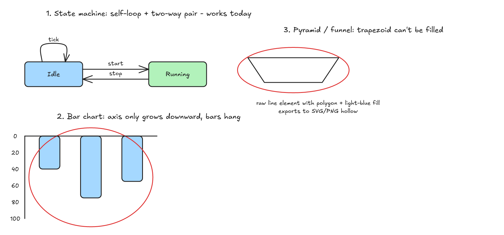
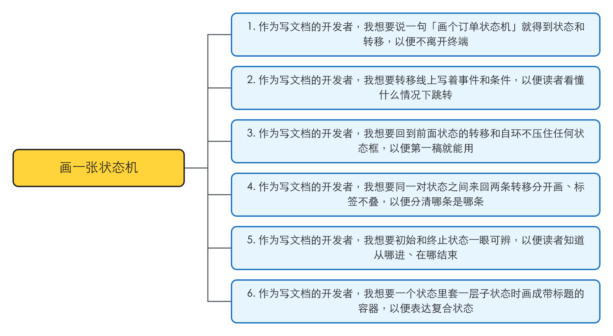
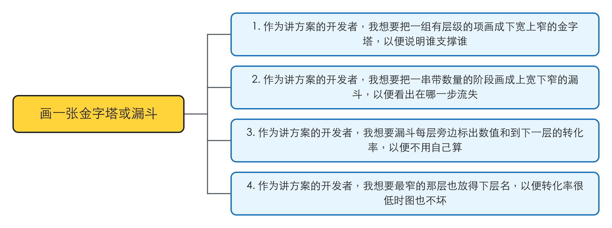
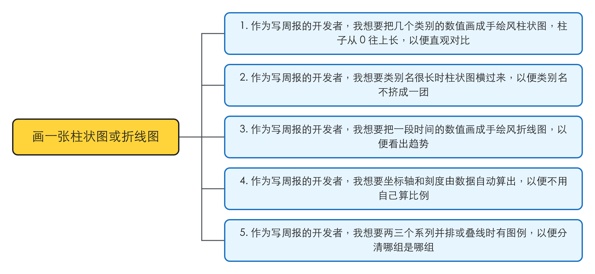
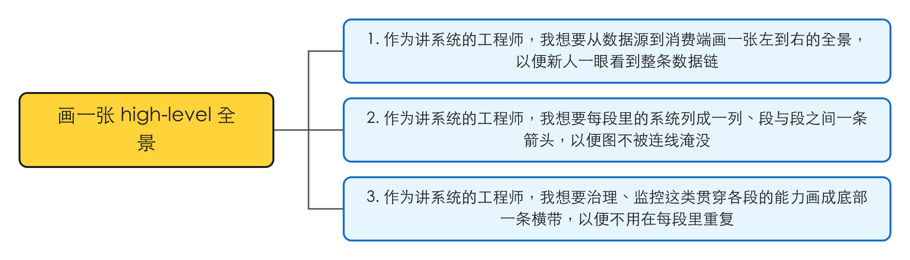
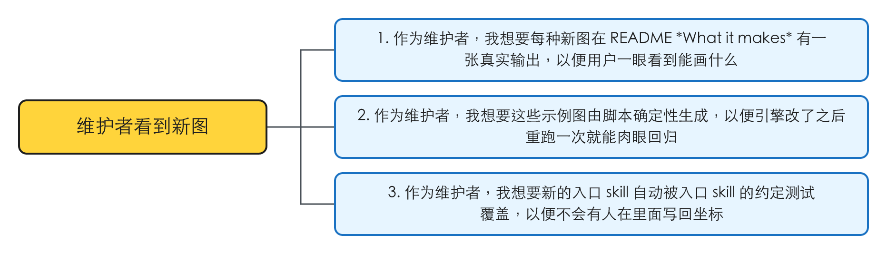
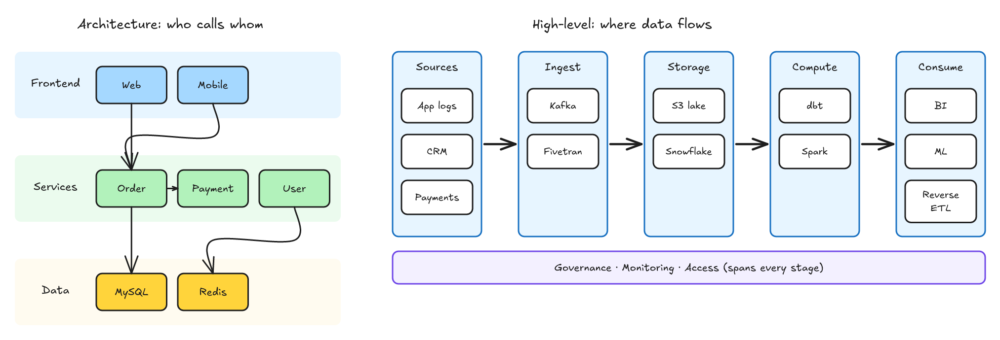

# 新图类型：状态机、金字塔/漏斗、柱状/折线、high-level 全景

这是一份总 spec：定每种图长什么样、问什么、共用什么，以及实现怎么切成能并行的单位。每个单位由 #15 会话各开一个实现子会话，各自从 `release/0.6.0` 切分支、PR 合回 `release/0.6.0`。

## 验证

| issue | 结论 | 证据 |
|---|---|---|
| #12 New diagram types | 存在 | 2026-10-28 对着 `origin/release/0.6.0`（4405ead，已含组件层与 skill 分层）核：五种图在 `skills/`、`src/` 下都没有入口；用现有组件拼三种关键形状，柱状图的柱子倒挂、梯形填不了色，状态机的自环和双向转移能画。详情见「问题」 |

## 问题

### 1. 想画的五种图没有入口，其中两种用现有组件画不对

2026-10-28 在 `release/0.6.0` 上，照入口 skill 的做法，只用现有组件（形状、连线、axis、stack）各拼了一块：

| 图 | 拼的是什么 | 看到什么 | 本该是什么 |
|---|---|---|---|
| 状态机 | 两个状态，一对方向相反的转移（`start` / `stop`），一个自环（`tick`） | 能画：双向转移用连线的固定出入边加偏移分开，自环用 U 形绕行回到同一条边；Layer A 零警告 | 同左。缺的只是一份写法，没有组件缺口 |
| 柱状图 | 竖轴 0–100，三根柱子 40 / 75 / 55 | 柱子从顶上往下挂：axis 竖着只能向下长（0 在上、100 在下），`domain` 又不许倒过来写（首大于尾直接报错） | 0 在底、柱子向上长。现在只能让 agent 自己算「基线减去数值乘比例」，正是组件层要去掉的手算 |
| 金字塔 / 漏斗 | 一层梯形：原始 `line` 元素写了闭合、浅蓝填充 | 导出的 SVG / PNG 只有轮廓，填充丢了：线条一律按不填色导出；sugar 也没有多边形这种形状 | 每层一个填了色的梯形，文字压在上面读得清 |
| 折线图 | 没单独拼：数据点和折线用 axis 的换算加连线就能画 | 跟柱状图同一个缺口：数值越大点越往下 | 数值越大点越高 |
| high-level 全景 | 没单独拼：几段 panel 横排、段间连线，architecture 已有的组件全够 | — | — |

想画状态机，现在最接近的是 flowchart：它按一条主线排，回边有写法，自环、同一对节点之间的双向转移、起止伪状态都没有写法。

复现材料：`.tmp/to-spec/new-diagram-types/repro/`（`evidence.mjs` 出这张图，`reversed-domain.txt` 是倒写 `domain` 的报错）

### 根因

不涉及（新功能）。两个组件缺口各有一处出处：axis 的方向只有向右、向下两种（组件层 spec 定的 `dir: "x" | "y"`）；线条导出时填充写死为不填。

## 方案

用户最终得到：在对话里说「画个订单状态机」「画个注册转化漏斗」「画个季度营收柱状图」「画个 DAU 折线」「画个数据栈全景」，有一个入口 skill 接住，问完该问的，第一稿就能放进文档；每种新图在 README *What it makes* 有一张真实输出。

每种图交付同一套东西，照 `skills/steps/SKILL.md`「新增一种图类型」的清单：一个只写自然语言的入口 skill（问清楚 → 构图 → 出图 → 常见画坏法），用到的组件写进 `steps` 对应的参考，命名表加一行，`CLAUDE.md` 和 README 加上它，`docs/gallery/` 加一张图，照真实请求画一张、Layer A 和 Layer B 都过。

下面逐种写形态和澄清问题。澄清问题里「内容」类的，用户说全了就不问（`steps`「clarify」的规则）；「怎么画」类的，内容推不出来、用户没说就照问。

### 状态机

一个系统在几个状态之间怎么跳：状态是圆角框，转移是带箭头的线，线上写「事件 [条件] / 动作」，没有的部分省掉。

- **布局**：主路径（从初始到终止最常走的那条）排成一行，其余状态另起一排放在下面，跟 flowchart 的主线加岔路同一个思路。回到前面状态的转移从主线不用的边走；同一对状态之间来回两条转移，各占一条边的两侧，不叠在一起；自环在状态框的一条空边上绕个小圈回来。
- **起止**：初始用一个实心小圆点加一条箭头指向初始状态；终止用双圈（外圈空心、内圈实心）。用户没提终止就不画。
- **复合状态**（状态里套子状态）：一层嵌套，子状态放在一个 panel 里，panel 的标题是父状态名。更深的嵌套不做。
- **澄清问题**：内容：有哪些状态、哪些转移和它们的事件 / 条件。怎么画：主路径横排还是竖排（状态名长、数量多时竖排）。

### 金字塔 / 漏斗

一组有先后的层：金字塔下宽上窄，讲层级或依赖（底层支撑上层）；漏斗上宽下窄，讲逐步流失，每层带一个数。

- **形状**：每层一个梯形，层与层之间留一道缝，整体左右对称。层宽按层序等步收窄，不按数值缩放：按数值缩放时，转化率低的最后一两层窄到放不下字。数值写在层的右侧，漏斗再在相邻两层之间写转化率。
- **文字**：层名压在梯形中间，宽度按这一层最窄的那条边算，放不下就折行、层跟着长高。
- **澄清问题**：内容：每层是什么、漏斗每层的数。怎么画：金字塔还是漏斗（给了逐层递减的数就是漏斗，只给层级就是金字塔，都不像才问）；漏斗显示绝对数、转化率还是都显示。

### 柱状图 / 折线图

只做简单的类别对比和趋势（issue 的 Non-goals）。

- **柱状图**：类别沿横轴，柱子从 0 往上长，柱顶写数值。类别名长（平均超过 8 个字符）或超过 8 个类别时横过来：类别沿竖轴往下排、柱子向右长。最多 3 个系列，多系列时同一类别的柱子并排、配 legend。
- **折线图**：时间沿横轴，数值轴从一个整齐的刻度起（不强求从 0），每个数据点画一个小圆点、点之间连线，最后一个点旁写数值。最多 3 条线，配 legend。
- **共用**：数值轴的刻度用 axis 的刻度（1 / 2 / 5 × 10ⁿ），刻度处画浅灰虚线网格，轴标题可选。手绘风是近似图，不追求像素精确。
- **澄清问题**：内容：类别或时间点、每个系列的数。怎么画：柱状还是折线（类别对比推柱状、按时间的推折线，两种都说得通才问）；单位和轴标题。

### high-level 全景

数据从哪来、经过哪几段、到哪去的端到端一张图，比如「数据源 → 采集 → 存储 → 计算 → 消费」。不单开入口 skill，做成 architecture 的第四种布局（见「实现决策」）。

- **布局**：每段一个 panel，从左到右排成一行，段名在 panel 顶上；段里的系统竖排成一列。段与段之间一条粗箭头，不画段内系统之间的连线（要画系统之间的连线就是 architecture 的图了）。贯穿所有段的能力（治理、监控、权限）画成整排下方的一条横带。
- **澄清问题**：内容：有哪几段、每段里有哪些系统、有没有贯穿的横带。

### 同一行为的其他入口

- **库 API 与 `compute_layout`（MCP 和 CLI 共用的工具定义）**：纳入。新组件三处都能调，跟 #26 的四个组件一样。
- **`generate -t` 内置模板**：排除。0.6.0 删除 `generate`（#15 发版时做）。
- **公开示例图库页（#25）**：排除。已移出 0.6.0；这里每种图只在 README 和 `docs/gallery/` 多一张。
- **harold-skills 里那套 skill**：排除，两套各自迭代（`CLAUDE.md`「Notes」）。
- **Mermaid `stateDiagram` 导入**：排除。#10（Mermaid 转换，已关闭）以后若做 `stateDiagram`，可以落到这里的状态机上，这次不碰。

## User Stories

### 画一张状态机

1. 作为写文档的开发者，我想要说一句「画个订单状态机」就得到状态和转移，以便不离开终端
2. 作为写文档的开发者，我想要转移线上写着事件和条件，以便读者看懂什么情况下跳转
3. 作为写文档的开发者，我想要回到前面状态的转移和自环不压住任何状态框，以便第一稿就能用
4. 作为写文档的开发者，我想要同一对状态之间来回两条转移分开画、标签不叠，以便分清哪条是哪条
5. 作为写文档的开发者，我想要初始和终止状态一眼可辨，以便读者知道从哪进、在哪结束
6. 作为写文档的开发者，我想要一个状态里套一层子状态时画成带标题的容器，以便表达复合状态

### 画一张金字塔或漏斗

1. 作为讲方案的开发者，我想要把一组有层级的项画成下宽上窄的金字塔，以便说明谁支撑谁
2. 作为讲方案的开发者，我想要把一串带数量的阶段画成上宽下窄的漏斗，以便看出在哪一步流失
3. 作为讲方案的开发者，我想要漏斗每层旁边标出数值和到下一层的转化率，以便不用自己算
4. 作为讲方案的开发者，我想要最窄的那层也放得下层名，以便转化率很低时图也不坏

### 画一张柱状图或折线图

1. 作为写周报的开发者，我想要把几个类别的数值画成手绘风柱状图，柱子从 0 往上长，以便直观对比
2. 作为写周报的开发者，我想要类别名很长时柱状图横过来，以便类别名不挤成一团
3. 作为写周报的开发者，我想要把一段时间的数值画成手绘风折线图，以便看出趋势
4. 作为写周报的开发者，我想要坐标轴和刻度由数据自动算出，以便不用自己算比例
5. 作为写周报的开发者，我想要两三个系列并排或叠线时有图例，以便分清哪组是哪组

### 画一张 high-level 全景

1. 作为讲系统的工程师，我想要从数据源到消费端画一张左到右的全景，以便新人一眼看到整条数据链
2. 作为讲系统的工程师，我想要每段里的系统列成一列、段与段之间一条箭头，以便图不被连线淹没
3. 作为讲系统的工程师，我想要治理、监控这类贯穿各段的能力画成底部一条横带，以便不用在每段里重复

### 维护者看到新图

1. 作为维护者，我想要每种新图在 README *What it makes* 有一张真实输出，以便用户一眼看到能画什么
2. 作为维护者，我想要这些示例图由脚本确定性生成，以便引擎改了之后重跑一次就能肉眼回归
3. 作为维护者，我想要新的入口 skill 自动被入口 skill 的约定测试覆盖，以便不会有人在里面写回坐标

## 实现决策

### 五种图都进 0.6.0，按图类型并行实现

依据：人的决定，经 #15 会话转达（2026-10-28）：「0.6.0 把五种图全做……#12 先定一份总 spec，再按图类型并行开子会话实现」。

### 每种图一个只写自然语言的入口 skill，不加内置模板

依据：`skills/steps/SKILL.md`「新增一种图类型」：「一种图只有 `SKILL.md` 一个文件……正文是固定的四步」；`generate` 0.6.0 删除（#15 的发版待办）。入口 skill 的约定由 `tests/skills-entry.test.mjs` 守，它从目录发现入口 skill，新目录一建就被覆盖。

### 状态机是独立的图类型，几何用现有组件

依据：用户全局约定原话「If the diagram type isn't one of its four (flowchart / architecture / sequence / timeline) — e.g. a state machine — say so rather than improvising in another format; I'll extend the plugin」。复现证明自环、双向转移用现有连线画得出（「问题」1）。不新加组件：主路径用 stack 排，转移是连线，复合状态是 panel。缺的两种写法（自环、同一对状态之间的双向转移）加进 `steps` 的连线参考，跟回边、长距离绕行写在一起。

### axis 加一个向上的方向

柱状图（竖着的）和折线图要数值越大越往上。axis 加第三个方向：从起点往上长，刻度和 `scale` 跟着反过来，换算仍是「起点 + (数值 − 下限) × 每单位像素」，只是每单位像素是负的。`domain` 仍然只许首小于等于尾。不改 `"x"`、`"y"` 现有的行为，时间线不受影响。

依据：组件层 spec 定了 axis 给 #12 的图表用（`docs/spec/layout-components`「axis」一节）；复现里倒写 `domain` 报错、向下的轴让柱子倒挂。「默认改动最小」：加一个方向，不重做 axis。

### 新组件：一组逐层收窄的梯形

金字塔和漏斗共用一个组件：给它层的列表（每层的文字，漏斗再带数）、朝向（上窄或下窄）、最宽一层的宽度，返回每层梯形的四个角、层名能用的文字框（按这一层最窄的边算，折行后层长高）、右侧数值的锚点、相邻两层之间转化率的锚点。只返回坐标，跟 #26 的四个组件一样经库、`compute_layout`、CLI 三处可调，参数类型错一律抛错、写明组件名与参数（#26 定的边界）。

依据：梯形的斜边坐标、每层能放字的宽度都要算，交给 agent 就是手算几何，正是组件层要去掉的（`docs/spec/layout-components`「问题」）。

### 新形状：填了色的多边形

sugar 加一种多边形形状：给一串顶点和填充色，导出成闭合、填色的多边形，Excalidraw 里打开是一个闭合的线条元素。Layer A 把它当成跟矩形同等的形状：参与重叠、连线穿框、文字与底色对比度的检查，范围取顶点的外接矩形。

依据：复现里线条的填充在导出时丢了（「问题」1）。只为梯形加形状，不加通用的多边形绘图能力，「默认改动最小」。

### 柱子、折线、网格线由 axis 的换算画，不加图表组件

依据：组件层 spec 的边界（`skills/steps/references/axis.md`「图表坐标轴」）：「柱子、折线、数据点、网格线不在 axis 里，用 `scale` 自己画」。axis 向上之后，柱子的位置和高度都是一次换算，不需要新组件。

### 示例图：每种图一个 figures 模块，`examples/gallery.mjs` 只多一行调用

每个单位把自己的示例写在一个新的 `examples/<类型>-figures.mjs` 里，`gallery.mjs` 只加它的导入和一次调用，README *What it makes* 只加它的格子。PNG 只提交自己那一张；重跑 `gallery.mjs` 后别的 PNG 变了，说明改动漏到了别的图，停下查。

依据：现存实例 `examples/tree-figures.mjs`、`examples/comparison-figures.mjs`；`CLAUDE.md`：「`docs/gallery/` … Generated by `node examples/gallery.mjs` (deterministic) … these PNGs are committed」。

### 并行单位

五个单位。「登记」最先合，之后四个单位互不依赖、任意顺序合。

| 单位 | 交付 | 依赖 | 新建的文件 | 碰的共享文件 |
|---|---|---|---|---|
| 登记 | 三个新入口 skill（状态机、金字塔 / 漏斗、图表）的名字先登记到所有列名单的地方，后面四个单位就不再改这几处 | 无 | 无 | `skills/steps/SKILL.md`（frontmatter 与开头的入口 skill 名单、「出图」命名表加三行、开头的行号表）；`CLAUDE.md`（`skills/` 一节的入口 skill 名单、Source layout）；README（「Six diagram types」改成 Nine）；`docs/diagram-types.md`（Status 行指向本 spec） |
| 状态机 | 状态机入口 skill；连线参考加自环、双向转移两种写法；一张示例 | 登记 | 状态机入口 skill；状态机 figures 模块；示例 PNG | `skills/steps/references/connectors.md`；`examples/gallery.mjs`（一行）；README（一格）；`CHANGELOG.md`（Unreleased 一条） |
| 金字塔 / 漏斗 | 梯形组件；多边形形状；金字塔 / 漏斗入口 skill；两张示例（金字塔一张、漏斗一张） | 登记 | 入口 skill；梯形组件的参考；figures 模块；组件与形状的测试；示例 PNG | `src/layout.mjs`（末尾加新组件）；`src/tools/compute-layout.mjs`（派发表与说明各加一项）；`src/index.mjs`（导出）；`src/sugar.mjs`、`src/elements.mjs`、`src/export.mjs`、`src/validate.mjs`（多边形）；`skills/steps/references/shapes.md`；`skills/steps/SKILL.md`「组件」表加一行（行号表跟着改）；`CLAUDE.md` Source layout；gallery 一行、README 两格、CHANGELOG 一条 |
| 柱状 / 折线 | axis 向上；图表入口 skill；两张示例（柱状一张、折线一张） | 登记 | 入口 skill；figures 模块；示例 PNG | `src/layout.mjs`（只改 `axis` 函数内部）；`src/tools/compute-layout.mjs`（只改 axis 那一行说明）；`skills/steps/references/axis.md`；`tests/axis.test.mjs`；gallery 一行、README 两格、CHANGELOG 一条 |
| high-level | architecture 的第四种布局（构图一节、问清楚一问、触发词）；一张示例 | 登记 | figures 模块；示例 PNG | `skills/architecture/SKILL.md`（只有这个单位碰）；gallery 一行、README 一格、CHANGELOG 一条 |

避免冲突的约定：

- **登记先合，四个单位从它之后的 `release/0.6.0` 切。** 不先登记，新建入口 skill 的三个单位都要改 `skills/steps/SKILL.md` 开头的行号表（`tests/skills-steps.test.mjs` 核它）和 `CLAUDE.md` 同一行的名单，每合一个，后面的都冲突。登记之后，只有金字塔 / 漏斗还碰 `skills/steps/SKILL.md`（「组件」表加一行）。
- **`src/layout.mjs`、`src/tools/compute-layout.mjs` 两个单位都碰，但不碰同一处**：柱状 / 折线只改 `axis` 函数和它那一行说明；金字塔 / 漏斗只在文件末尾、派发表末尾加新项。
- **gallery、README、CHANGELOG 是追加式冲突**：每个单位只加自己的一行、一格、一条。开 PR 前合一次最新的 `release/0.6.0`，冲突两边都留，再跑 `npm test` 和 `node examples/gallery.mjs`。
- **跟 #35 #36 #38 小修会话的重叠**：它改 `skills/steps/`（连线参考、Layer B）和 `src/sugar.mjs`（中文箭头标签估宽）。登记、状态机（连线参考）、金字塔 / 漏斗（`src/sugar.mjs`）后合的一方合最新的 `release/0.6.0` 再开 PR，`skills/steps/SKILL.md` 的行号表按测试报的改。
- **CHANGELOG 只写在 Unreleased 下**；版本号、插件版本由 #15 会话发版时改。

### high-level 是 architecture 的第四种布局，不单开入口 skill

architecture 的「构图」在经典分层、分层加子分组、自由拓扑之后加一种「左到右的数据全景」；「问清楚」多一问：要讲的是调用关系（分层），还是数据流向（全景），用户的话已经说明的不问。frontmatter 的触发词补上数据全景、data stack、high-level 这几个说法（已有「数据中台 / data platforms」）。输出文件名仍是 `architecture-<名字>`，不新加命名。例：「画个数据栈全景」进 architecture，选全景布局，横向五段：数据源 → 采集 → 存储 → 计算 → 消费。

两者的差别（`docs/diagram-types.md` 留开的「depends on how much its layout actually differs」）：architecture 是上下叠放的层、层里横排服务、服务之间画调用；high-level 是左右排开的段、段里竖排系统、只画段与段之间的流向。用到的组件一样（panel、stack、连线）。

依据：人 2026-10-28 的原话「high-level 做成 architecture 的第四种布局。」

### 柱状图和折线图共用一个图表入口 skill

构图里分柱状、折线两节，坐标轴、刻度、图例的说法写一处；用户只说「把这组数画成图」时，它按数据是类别还是时间推荐柱状或折线。例：「画个营收柱状图」「画个 DAU 折线」都进它。

依据：人 2026-10-28 的原话「柱状图和折线图，金字塔和漏斗按照推荐来吧」。

### 金字塔和漏斗共用一个入口 skill

构图里分金字塔、漏斗两节，按给没给逐层递减的数判朝向。例：「画个需求层次金字塔」「画个注册转化漏斗」都进它。

依据：同上，人 2026-10-28 的原话。

### 新名字

| 名字 | 是什么 | 用户在哪看到 |
|---|---|---|
| `state-machine` | 状态机入口 skill | 插件的 skill 列表；输出 `state-machine-<名字>.png` |
| `pyramid` | 金字塔 / 漏斗入口 skill（漏斗也走它） | 输出 `pyramid-<名字>.png`，漏斗图也是这个前缀 |
| `chart` | 柱状 / 折线入口 skill | 输出 `chart-<名字>.png` |
| `taper` | 逐层收窄的梯形组件 | `compute_layout` 的 helper 名；`steps` 的参考 `taper.md` |
| `"up"` | axis 向上的方向值，跟 `"x"`（向右）、`"y"`（向下）并列 | axis 的 `dir` 参数 |

依据：人 2026-10-28 的原话「新名字都用推荐：state-machine、pyramid、chart、taper、"up"。」

## 技术方案总览

### 后端

不涉及。

### 前端内部

不涉及。

### 前端交互

不涉及（产品界面是 skill、CLI、MCP 和输出的图本身，没有页面）。

## 测试决策

| 变的是什么 | 仪器 | 本次 |
|---|---|---|
| 纯逻辑、数据转换、状态机 | TDD 单元测试 | 碰到：axis 向上的标记点、刻度、`scale`；梯形组件的几何不变量（层不重叠、左右对称、逐层收窄、文字框落在梯形内、参数错抛错）；多边形经 sugar 展开、导出带填充、Layer A 把它当形状 |
| API 契约（路由、schema、序列化） | TDD API 测试 | 碰到：`compute_layout` 多出梯形组件，axis 多一个方向；工具测试断言输入与输出形状 |
| DB schema、迁移、并发与事务语义 | 真 DB 测试 | 不涉及 |
| LLM 输出质量（prompt 改动） | eval（确定性断言） | 不涉及：仓库没有 eval 套件（`docs/agent-eval.md` 仍是设计稿）；入口 skill 的约定由 `tests/skills-entry.test.mjs` 守，示例图由人看 |
| 视觉正确性 | UI 实现环 | 不涉及 UI 实现环；示例 PNG 由人在 PR 里看，配合 `steps`「出图」的 Layer B 看图自检 |
| 端到端用户流程 | 浏览器端到端测试 | 不涉及 |

- **seam**：
  - 组件的公共函数（库入口导出的 `axis`、梯形组件）：喂结构化输入、读坐标。抓得到几何错；抓不到入口 skill 写得让 agent 用错。
  - `compute_layout` 工具定义：抓得到 MCP / CLI 契约漂移；抓不到渲染外观。
  - `desugar` + `validate` + 导出：喂含多边形的 sugar，读元素、警告和 SVG。抓得到填充丢失、Layer A 漏检；抓不到好不好看。
  - 入口 skill 约定测试（已有，自动覆盖新目录）：抓得到入口 skill 里写了坐标、工具名、sugar 字段；抓不到写法对不对。
- **增量功能测试**：
  - 前置：竖轴 0–100、从基线往上、5 个刻度。步骤：调 axis。期望：值 0 的刻度在基线上，值 100 的在基线上方一个轴长；值 40 的换算坐标在两者之间、比值 75 的低。覆盖：画一张柱状图或折线图 1、4。
  - 前置：4 层漏斗，数值 1000 / 400 / 120 / 30，最宽层给定。步骤：调梯形组件。期望：层自上而下逐层收窄、互不重叠、左右对称；每层的文字框落在梯形内；最后一层放得下一个约 12 字符的层名（折行后层长高）。覆盖：画一张金字塔或漏斗 2、4。
  - 前置：一个多边形 sugar，填浅蓝。步骤：展开、导出 SVG、跑 Layer A。期望：SVG 里是填了浅蓝的闭合多边形；它与一个矩形重叠时 Layer A 报重叠。覆盖：画一张金字塔或漏斗 1。
  - 前置：`examples/gallery.mjs`。步骤：连跑两次。期望：PNG 字节一致，每张新图 Layer A 零警告。覆盖：维护者看到新图 1、2。
  - 前置：每个新入口 skill。步骤：照一个真实请求画一张图（「新增一种图类型」清单第 6 条）。期望：Layer A、Layer B 都过，PR 里附这张图。覆盖：各场景 1。
- **prompt / eval 变动**：无 prompt/eval 变动（入口 skill 新增，但仓库没有 eval）。
- **照着谁写**：`tests/axis.test.mjs`、`tests/stack.test.mjs`（组件的几何不变量与抛错）、`tests/tools.test.mjs`（`compute_layout` 契约）、`tests/sugar.test.mjs`、`tests/validate.test.mjs`。

## Out of scope

- 树：已由 #19 做掉。
- 公开示例图库页：#25，已移出 0.6.0。
- `generate -t` 内置模板：0.6.0 删除。
- 通用图表能力（双轴、堆叠、饼图、交互、像素精确）：issue Non-goals。
- 状态机两层以上的嵌套、并发区域（正交状态）：一层嵌套够用，更深的超出手绘图能读清的范围。
- 通用的多边形绘图（任意形状）：只为梯形加，见「新形状」。
- 移植 diagram-design 的全部 27 种图：issue Non-goals。
- harold-skills 里那套 skill：独立迭代。

## 关联

- 覆盖：#12 New diagram types
- 设计笔记：`docs/diagram-types.md`
- 相邻 spec：
  - `layout-components`（#26，已合进 `release/0.6.0`）：axis、stack、panel、legend 的接口以它为准；这里给 axis 加一个方向、另加一个组件，不改它定的边界。
  - `skill-layers`（#27，已合进 `release/0.6.0`）：入口 skill 的写法以它和 `skills/steps/SKILL.md`「新增一种图类型」为准。
  - `example-gallery`（#25，搁置）：公开页以后展示这里加的图，不重叠。
- 相邻未完成的 issue：
  - #15 0.6.0 feature list：总 issue，按本 spec 的并行单位开实现会话，最后发版。
  - #35 连线绕行距离、#36 Layer B 折行孤词、#38 中文箭头标签估宽：同在 `release/0.6.0` 上并行，文件重叠见「并行单位」。
  - #17 手绘风图标：high-level 全景放图标时会用到；不阻塞，先用文字框。
